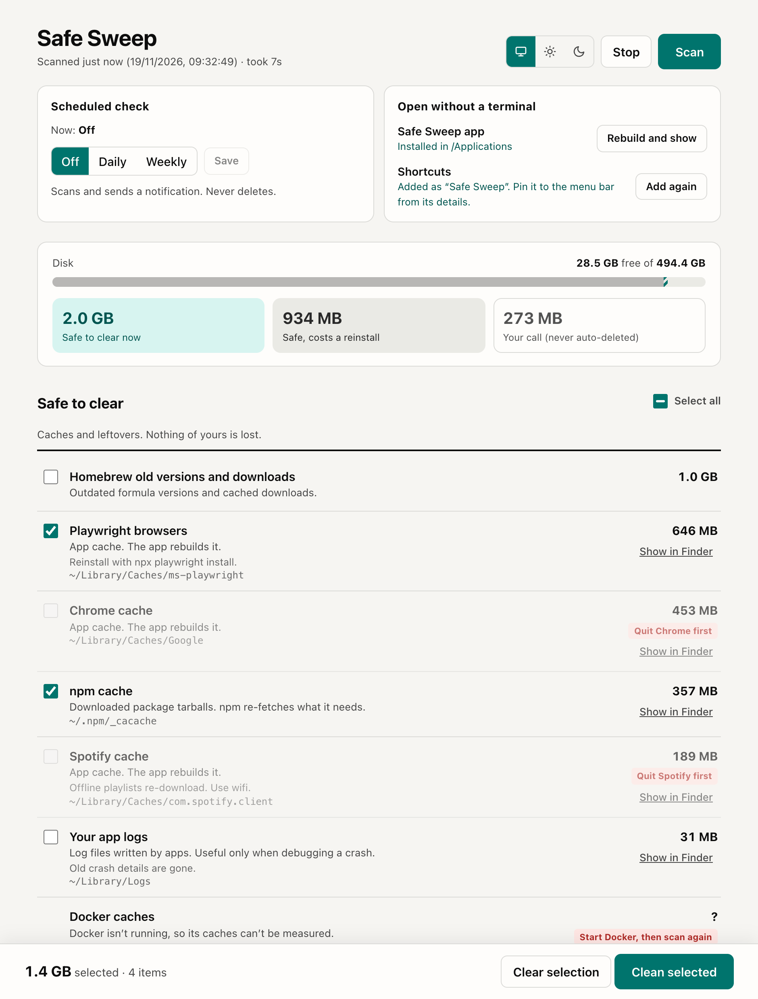

# safe-sweep

Find disk space you can free on your machine, and delete only what you tick.

safe-sweep scans for caches, build leftovers and dormant `node_modules`, sorts them by how safe they are to remove, and shows you the sizes. Nothing is deleted until you tick it and confirm. It runs as a small page on your own machine: no account, no network calls, no telemetry.

Website: [safesweep.morayodeji.dev](https://safesweep.morayodeji.dev/)

<picture>
  <source media="(prefers-color-scheme: dark)" srcset="https://raw.githubusercontent.com/d-beloved/safe-sweep/main/docs/screenshot-dark.png?v=4">
  
</picture>
<sub>Screenshot uses sample sizes. The page follows your system’s light or dark setting.</sub>

**Platforms:** macOS and Linux. Linux support is new: please [open an issue](https://github.com/d-beloved/safe-sweep/issues) if something looks wrong. See [Platform support](#platform-support).

## Install

Published on npm as [@d-beloved/safe-sweep](https://www.npmjs.com/package/@d-beloved/safe-sweep). Needs Node 20 or newer. No dependencies.

```bash
npm install -g @d-beloved/safe-sweep
safe-sweep      # opens the Scan page in your browser
```

To try it once without installing, run `npx @d-beloved/safe-sweep`. Scan and clean work the same. A schedule or launcher needs the installed version, because npx runs from a temporary folder.

To work on the code, clone the repo and run `npm link` in it instead.

The first run creates `~/.safe-sweep/config.json`. On macOS, Terminal may ask for access to Desktop or Documents. Allow it, or projects there won't be found.

## How it works

1. Press **Scan**. Sizes are measured, not estimated.
2. Tick what you want gone. Each list has a **Select all** box, and **Clear selection** unticks everything. An item that says *Quit Chrome first* (or another app) becomes tickable by itself a few seconds after you close that app. No new scan needed.
3. Press **Clean selected** and confirm. The result shows what each item freed and how much your free space really went up.

The scan is saved, so refreshing the page keeps it. Cleaning needs a scan from the last hour, because sizes drift.

### The three lists

**Safe to clear.** Caches and leftovers that rebuild themselves. Docker build cache and dangling images, npm / yarn / pnpm / bun / uv caches, `brew cleanup`, app caches (Chrome, Firefox on Linux, Spotify, Codex, Playwright), named dev caches in `~/.cache` (pip, Prisma, Puppeteer and others), image thumbnails on Linux, and on macOS app-updater leftovers and app logs.

**Safe, costs a reinstall.** Comes back with a download or an install command. Hugging Face models, Chrome's on-device AI model, `_to_delete` folders, and `node_modules` in dormant projects. A `node_modules` folder is only offered when:
- the project has had no commit or file change for `dormantDays` (default 60),
- its lockfile is committed to git, so a reinstall gives the same versions,
- its path doesn't match anything in your `protect` list.

**Your call.** Shown so you know where space went, with a button to open the folder. safe-sweep never deletes these: Downloads, Trash, Movies or Videos, old Node and Ruby versions, loose installers. On macOS also WhatsApp media and Docker's virtual disk. On Linux also apt, dnf, pacman and Snap package caches, Flatpak runtimes and the system journal, each with the command that clears it. Those need `sudo`, and safe-sweep never asks for it.

## Safety

This tool deletes files, so it is built to refuse first.

- **Allowlist.** It deletes only inside a fixed list of path patterns per OS (`src/core/rules.js` plus `src/platform/<os>/rules.js`). Anything else is refused, even if a rule asks for it.
- **Denylist.** Every `.git` folder, chat data (WhatsApp), and cloud-synced folders (iCloud, Google Drive, Dropbox, OneDrive, Nextcloud) are blocked even if an allowlist pattern matches. On Linux, so are the Trash, `~/.ssh` and `~/.gnupg`.
- **Symlinks.** Paths are checked as written and with symlinks resolved. A target that is itself a symlink is refused.
- **Open apps.** It re-checks that the app is closed (Chrome, Firefox, Spotify, Cursor, Codex) right before clearing its cache.
- **Docker.** It never runs `docker image prune -a` or `docker volume prune`. With zero containers, Docker counts every image and volume as unused, including the ones you need.
- **Local only.** The page is served on `127.0.0.1`, checks the Host header, and needs a per-session token on every action, so other websites can't trigger a clean.
- **Logged.** Every clean is written to `~/.safe-sweep/log.jsonl`. Run `safe-sweep log` to read it.

The delete guard has its own tests (`npm test`). Read `src/core/guard.js` before trusting it with your disk: it's about 40 lines.

## Commands

| Command | What it does |
|---|---|
| `safe-sweep` | Starts the page at http://127.0.0.1:4777 and opens it. Stops after 15 idle minutes, or press **Stop**. |
| `safe-sweep scan` | Prints the list in the terminal. Deletes nothing. Add `--json` for raw output. |
| `safe-sweep check` | Scans and sends a notification if free space is low or a lot is reclaimable. |
| `safe-sweep schedule weekly --day 1 --hour 10` | Runs `check` every Monday at 10:07. |
| `safe-sweep schedule daily --hour 9` | Same, every day. |
| `safe-sweep schedule off` | Removes the schedule. |
| `safe-sweep schedule` | Shows the current schedule. |
| `safe-sweep log` | Shows what was cleaned, when, and how much it freed. |

Scheduled runs only scan and notify. They never delete.

## Opening it without a terminal

On macOS, from the page:
- **Create app** builds `Safe Sweep.app` in `/Applications` (or `~/Applications` if that isn't writable). It opens from Spotlight, Launchpad or the Dock.
- **Add to Shortcuts** builds a shortcut and opens Shortcuts' own Add dialog. It needs Shortcuts → Settings → Advanced → **Allow Running Scripts**. That setting applies to every shortcut, so only add shortcuts you trust. The app needs no such setting.

On Linux, **Add to menu** writes `~/.local/share/applications/safe-sweep.desktop`. Safe Sweep then opens from your app launcher.

## Config

`~/.safe-sweep/config.json`. Changes apply the next time safe-sweep starts.

```json
{
  "projectRoots": ["~/Desktop/Projects", "~/Projects", "~/Developer", "~/code", "~/dev", "~/src"],
  "protect": [],
  "dormantDays": 60,
  "notify": { "minFreeGB": 30, "minReclaimableGB": 10 },
  "port": 4777
}
```

- `projectRoots`: where to look for `node_modules` and `_to_delete` folders. Missing folders are skipped.
- `protect`: substrings of project paths whose `node_modules` are never offered, e.g. `["work-monorepo"]`.

## Platform support

| | macOS | Linux |
|---|---|---|
| Scan and clean | ✅ | ✅ |
| Scheduled check | ✅ launchd | ✅ systemd user timer |
| Notifications | ✅ | ✅ `notify-send`, if installed |
| Open without a terminal | ✅ app and Shortcuts | ✅ menu entry (`.desktop`) |

On any other OS, safe-sweep exits with a message and touches nothing. Each OS is one folder under `src/platform/`. See [CONTRIBUTING.md](CONTRIBUTING.md).

## Known gaps

- Docker Desktop frees pruned space inside its disk file. Your real disk may not get it back until Docker Desktop restarts.
- On macOS, sizes for Trash, Downloads and Desktop need Terminal to have Full Disk Access. Without it they show `?`.
- The schedule and launchers pin the Node binary you created them with. If you remove that Node version, the page flags them. Save and rebuild them.
- On Linux, the scheduled check needs systemd. Without it, scheduling shows an error and the rest works.
- The shortcut file is hand-built. If `shortcuts sign` rejects it on your macOS version, the page shows the error. Use the app instead.

## License

MIT. See [LICENSE](LICENSE).
